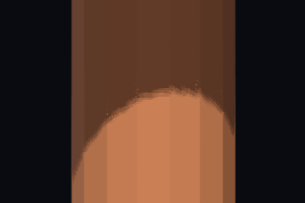
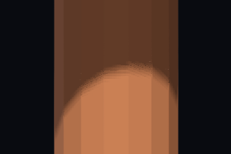

# Coarse shadow edge grain diagnosis

Measured on Metal native from engine base `dcb0599e3`. No renderer change is proposed for this commit.

`TemporalGameShadowGrainGpuTests.Coarse_shadow_texels_on_a_swaying_faceted_receiver_report_grain_against_fxaa`
uses a uniformly coloured, flat-shaded 16-sided torso. Its still orthographic camera presents 384 by 256,
0.56 world units tall. Shadows use default 2048 by three cascades, biases, normal offset and strength.
Temporal sharpness is 0.25. The front face lies in cascade 0, with projected shadow rows 5.03 display pixels apart.
The default hold threshold corresponds to 3.44 pixels of edge travel. At one pixel per frame the matrix-refit
sequence is `1000100010001000`. At four and eight it adopts every frame. Keyed sway peaks at 0.2 pixels per frame.

Each path warms for 80 frames and measures frames 80 to 95. Quality, Native and FXAA use the same light and receiver
path. The non-temporal reference renders at 4x per axis, CPU box filtered, with hold off. Each filter variant uses
its own spatial reference. Its error measures fidelity to that filtered scene, not to the original edge width.

The band follows each reference column's half-contrast crossing, extending 40 pixels each way. The control starts
64 pixels away. A four-pixel guard excludes normal seams. Grain is absolute luma minus its 3x3 median. Width is
the mean column distance between 10 and 90 percent of the lit-to-shadow contrast.

## Attribution

[metrics.json](metrics.json), [metrics.csv](metrics.csv) and [run-tables.txt](run-tables.txt) contain both hold
settings, region metrics and per-frame release percentages. Luma uses 0 to 1.

| Run | Temporary change |
| --- | --- |
| baseline | Current resolve and 3x3 point-comparison PCF |
| a | Force `released` false after the evidence tests |
| b | Multiply hold, accumulated weight and display reconstruction share by one minus a smooth release share |
| c | Hold zero rows in the baseline table |
| d | Fixed 5x5 atlas-grid PCF, radius two texels, 25 comparisons |
| e | d plus a |
| f | Supplemental current-only control, history reuse off, reconstruction and sharpening retained |

For b, the share is `smoothstep(0.85, 2.55, abs(historyYcc.x - current.x) / (Jitter.z * releaseExtent))` where the
existing predicate passes. Percentages count predicate hits, not the fractional history removed. The temporary
release mask reports `released` through `TemporalPixel.reactive`. Reactive red above 127 identifies released
pixels. Ordinary Reactive does not measure this rule. All instrumentation and experimental renderer edits were restored.

All four facts, measurement, fresh-scene parity and both existing `TemporalStableDetailGpuTests`, pass for the
requested variants and restored renderer. The supplemental control passes both measurement facts. Measurement
assertions establish valid geometry and rendered, non-empty regions, with no quality bound.

## Result

No requested combination reaches FXAA grain across the moving cases. Disabling release leaves grain and increases
lag error. Hold is not required, since the four and eight pixel rows are identical with it off. The 5x5 filter
widens the still Native edge from 11.50 to 20.07 pixels without fixing grain. Existing detail bounds pass throughout.

The supplemental current-only control still measures grain 0.00061 Native and 0.00086 Quality versus FXAA
0.00029 at four pixels per frame. Removing history reduces baseline grain by 61 to 62 percent there. Thus the
current-frame path already has grain, and history amplifies it. This control does not separate reconstruction
from sharpening.

Exact GLSL locations in `ShaderSources.TemporalAccumulate.cs` are 210 to 212 and 280 to 283 for current
reconstruction, 452 to 458 for locks, 512 to 529 for selective release, and 580 to 589 for reconstruction selection
and blending. `ShaderSources.Lighting.cs` 85 to 100 supplies discrete point-comparison steps.
`ShaderSources.TemporalSharpen.cs` 49 to 52 applies the sharpen lobe. The next candidate is a non-ringing current
fallback on coherent shading changes, retaining current shadow width and still-detail guards. It is not validated here.

Frame 88, travel four, hold one:

| Baseline Quality | Baseline FXAA | Wider filter Quality |
| --- | --- | --- |
|  |  |  |

Run from the repository root after a Release build:

```bash
KE_GPU_TESTS=1 build-slot --label taa-game-shadow -- dotnet test KhaozEngine.Render.Tests -c Release --no-build --filter 'FullyQualifiedName~TemporalGameShadowGrainGpuTests' --logger 'console;verbosity=detailed'
```

`KE_SHADOW_GRAIN_EVIDENCE_DIR` writes PNGs. `KE_SHADOW_GRAIN_STILL=1` removes sway. `KE_SHADOW_GRAIN_RELEASE_MASK=1`
requires coordinated temporary instrumentation. Otherwise release fractions are unavailable.
