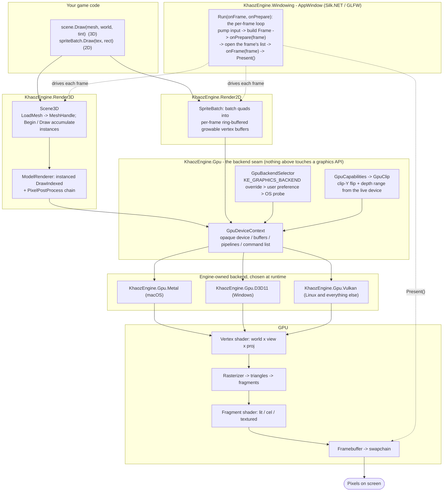
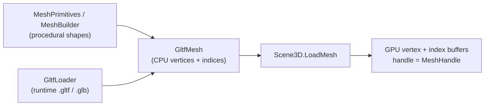
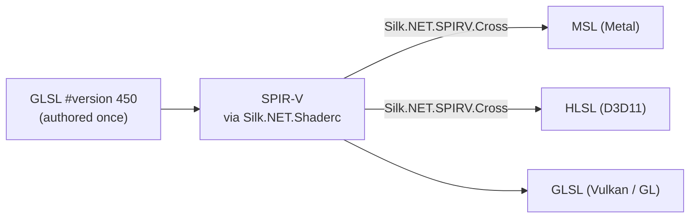
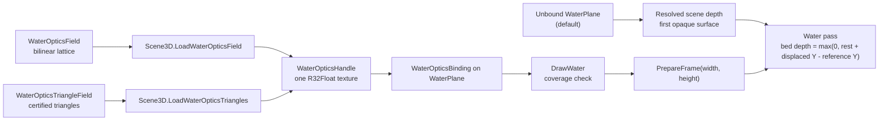

# Render pipeline: how C# becomes rendered triangles

A high-level (container / "Level 2") map of the path from a C# draw call to pixels on screen. Not line-by-line:
the boxes name the real types so you can jump into the code, but the detail stops at the layer boundaries. For
the GPU strategy rationale (the engine-owned backends, author-once GLSL) see
[CROSS-PLATFORM.md](CROSS-PLATFORM.md).

## The flow

## Two side-flows that feed it

**Geometry upload (CPU mesh -> GPU buffers), done once at load, not per frame:**

**Shaders are authored once in GLSL and cross-compiled at load** (the reason there is no per-platform shader
build step). Source lives inline in `Render3D/Internal/ShaderSources.cs` and `Render2D/SpriteBatch.cs`:

## The same path in words

1. Your game calls `Scene3D.Draw(...)` (3D) or `SpriteBatch.Draw(...)` (2D) inside a `Frame` callback that
   `AppWindow.Run` invokes once per frame. The loop runs TWO callbacks per frame, in this order: `onPrepare`
   with no command list open, then `onFrame` with the frame's list open and cleared by default. The explicit
   `AppWindow.RendererInitializesSwapchain` opt-in omits the initial output bind and clear, so the renderer must
   initialize the full output before 2D draws and capture taps. Final 3D composition still binds, clears and
   overwrites the entire output. `GameAppOptions` forwards the same opt-in, default false. `GameApp` splits its own
   body across them (`OnUpdate` + `OnPrepareWorld` in the first, `OnRenderWorld` + the 2D passes in the second),
   so a 3D game's `OnDraw3D` runs in the prepare phase and its recording in the record phase.
2. `Scene3D` accumulates draws as instances keyed by `MeshHandle` (geometry was uploaded once via `LoadMesh`);
   `SpriteBatch` packs quads into per-frame ring-buffered vertex buffers (rotated so a frame's write never races
   the GPU still reading an earlier, in-flight frame's copy). Nothing here references a graphics API.
3. Before anything is recorded, `Scene3D.PrepareFrame(width, height)` runs the frame's pre-recording phase: the
   subsystems whose per-frame GPU work needs a command list of their OWN (the FFT ocean's priming dispatch, which
   is a compute read-after-write and so needs a submit plus a device wait) do it here, where no frame list is
   open. The viewport-aware form also fixes the frame's render targets and builds the resource sets for bound
   optical water. The legacy no-argument `PrepareFrame()` throws when bound water is queued. `GameApp3D` prepares
   with its frame size in the loop's prepare phase. `Render3DPreview.Capture` and every `Render3DSnapshot`
   capture entry point call `Begin` themselves and prepare with their own target size, so a draw callback needs
   no preparation and one that also prepares at that size is a latched no-op. `CaptureWithBackend` returns the
   backend from that same render alongside the pixels. `CaptureSequence` retains one scene and target, renders
   warm-up without readback, then delivers each frame's pixels and backend synchronously. `Render3DSurface.Render`
   records inside the frame's open list and keeps a no-argument safety net, which is a no-op after `GameApp3D`'s
   call (issue #429), so bound water must already be prepared at the frame's size. A custom host calls
   `PrepareFrame(width, height)` after queueing and before recording. Opening a second command list while the
   frame's is recording is refused by the seam's open-recording register on every backend, which is why the
   phase exists and why it stayed when the backend that used to corrupt the frame instead of refusing was
   deleted (issues #423 and #690).
4. At frame end, `Render3DSurface` / `Render2DSurface` flush through `ModelRenderer` / the sprite shader, which
   record commands on `GpuDeviceContext` - the opaque seam (device, buffers, pipelines, command list).
5. `GpuBackendSelector` picked the backend at startup (`KE_GRAPHICS_BACKEND` override, then the game's stored
   user preference, then the OS probe, with a fallback if that backend cannot create a device), and `GpuCapabilities`
   /`GpuClip` fold per-backend clip-Y and depth-range differences in so the renderers stay backend-agnostic.
6. The seam drives the chosen engine-owned backend (`KhaozEngine.Gpu.Metal` / `.D3D11` / `.Vulkan`). Shaders were
   cross-compiled from one SPIR-V blob at load, so the same GLSL runs everywhere.
7. The GPU runs the vertex shader (world x view x proj), rasterizes to triangles + fragments, runs the fragment
   shader (lit / cel / textured), and writes the framebuffer. `AppWindow` calls `Present()` to put the
   swapchain image on screen.

## Terrain splat pipeline (second model-pass pipeline)

Terrain chunks rendered with a `TerrainLayeredMaterial` take a separate pipeline path inside `ModelRenderer`:
the `SplatFrag` shader samples two `texture2DArray`s (albedo + normal, 5 layers) and blends them per-fragment
using the splat weights baked into `ModelVertex.Color` (4 packed channels; the 5th is `1 - sum`). World-space
triplanar projection (`SplatProjection`) tiles each layer without seams across chunk borders. The two arrays
are created once per `TerrainLayeredMaterial` and shared by every chunk that uses it; a per-layer-scalar-roughness
params UBO provides roughness per layer. By default anisotropic filtering (16x) plus a `+1` mip
LOD bias (`GpuSamplerDescription.MipLodBias`) are applied where the device supports them - anisotropy covers
grazing angles, the bias biases distant ground to a blurrier mip so a high-frequency tiling albedo stops
shimmering as the camera moves. Anisotropy falls back to trilinear, and the LOD bias to 0, where the backend
lacks them (Metal has no sampler LOD bias). A material can override this per-material via
`TerrainLayeredMaterial.Sampler` / the `sampler` argument on `LoadSplatMaterial` (a `TerrainSamplerConfig`:
filter, max anisotropy, mip bias) - e.g. lower the anisotropy or switch to trilinear to blur the grazing floor
more where a noisy albedo aliases; null uses the shared default sampler and is byte-identical. Mipmaps are
generated at load time via
`IGpuCommandList.GenerateMipmaps`. A mesh with no splat material (`SplatMaterial == -1`) skips
the splat pass entirely and renders through the standard model pipeline, unchanged.

The per-layer blend runs in a loop with a `if (weight <= 0.001) continue;` early-out, which is data-dependent
(non-uniform) control flow across a fragment quad. Implicit-LOD `texture()` derivatives are undefined under such a
branch, so `SplatFrag` instead hoists `dFdx`/`dFdy` of the world position to uniform flow once before the loop and
samples with `textureGrad`, passing each triplanar plane's gradient (the world derivative scaled by that layer's
tile rate). This keeps the mip/anisotropic LOD well-defined regardless of the branch (an undefined LOD can collapse
toward mip 0 and alias the minified, high-frequency ground into distance "fuzz" on backends that do not gracefully
define it, e.g. D3D11), and lets the anisotropy + LOD bias act on a real gradient. `SplatTerrainDistanceGoldenTests`
guards this per backend at a grazing distance (the older `SplatTerrainGoldenTests` frames the ground top-down with
the orthographic iso camera and cannot exhibit distance minification).

`SplatVert`/`SplatFrag` keep their pixel-input interpolants contiguous from location 0 on purpose: a gap (a
fragment-unused interpolant declared below a used one) miscompiles on D3D11/WARP and rendered the terrain flat
white until a later fix. The cross-backend shader-authoring rules are in `docs/CROSS-PLATFORM.md` ("Authoring shaders
that pass on all three backends").

## Water depth sources

The water pass needs a depth below each water fragment for its colour grading, ordinary shore foam and shore
fade. Each `WaterPlane` selects its own source:

- **Unbound** planes reconstruct the first opaque surface from the resolved scene depth, which may be a creature or
  a prop. This is the unchanged legacy path, with no optical upload.
- **Bilinear fields** read four bounded texel fetches over an authored lattice. A vertical step softens across one
  lattice cell.
- **Triangle fields** read one bounded atlas: a bin of at most 32 candidate triangles, exact integer containment,
  then barycentric depth. TileWorld builds them from its actual ground meshes under
  `TileWaterDepthMode.AuthoredBed`.

Coverage is checked when the plane is queued, never per fragment. A bound fragment never falls back to scene depth,
and bound FFT water is refused until FFT has a certified displacement envelope. Scene depth still depth-tests every
plane, so geometry above the surface occludes it. The FFT shoaling and surf bathymetry is a separate scene-wide
input. API detail lives in the [Render3D package reference](../KhaozEngine.Render3D/README.md).

Underwater key lighting runs in the opaque receivers, using each plane's resolved `UnderwaterSunlight` opt-in.
Before the opaque pass, render-relative water slabs are binned into the shared point-light camera grid and uploaded
as one storage buffer appended to every lit receiver's set 0. Each fragment selects its containing slab, refracts
the sun at the still surface with index `1.333`, and samples key shadows at that entry point with the receiver's own
bias. Key diffuse and specular attenuate along the refracted path using the body's absorption. The query also works
with orthographic cameras and disabled shadows. Zero records skip buffer reads. Four jittered depth slices along
the refracted segment reconstruct stored caster heights below the surface and within each slice's height band.
The orthographic matrix's squared basis lengths keep reconstruction finite through exactly horizontal key light,
and a separate light-depth comparison excludes casters beyond horizontal endpoints. Non-horizontal slices
share world-height boundaries, so widened rays cannot open gaps through a roof. The final slice tests the
receiver's geometric plane on each displaced ray with its normal offset and existing depth bias. This signed
comparison avoids division by light elevation or plane slope and excludes upslope self-shadow. Slice lookups blend cascades,
with the outer coverage fade applied once at the real receiver so virtual points near the atlas border do not
brighten cave floors. The opaque atlas stores the sun-facing near side for outward CCW meshes under
orientation-preserving transforms, including glTF geometry whose winding the loader preserves. A straddling box's
above-water face therefore shadows the entry lookup already. Fully submerged rocks and cave roofs need the march.
One retained caster per atlas texel can hide a submerged caster behind another one. The entry kernel widens the
dry filter's weighted 4x4 footprint at a fixed 16 point comparisons, morphing positions and weights into a
centred, stratified equal-weight pattern over the first texel of widening. Its radius is
`min(8, 1 + L * UnderwaterPenumbraPerMetre / texelWorld)`, converted separately for each cascade. Rotation and
positional jitter grow from zero with widening, so zero widening uses the exact dry kernel. Added entry-tap
displacement adjusts comparison depth along the horizontal water plane, relative to the original dry tap, so
outer rays cannot pass above shallow casters. The four slice rays spread with the same radius without adding
comparisons, evaluating depth bands on each offset texel's light ray.
This path does not depend on either authored water-depth source above.

## Where to look in the code

| Box | Type / file |
|---|---|
| Frame loop + window + swapchain | `KhaozEngine.Windowing/AppWindow.cs` (`Run`, `GpuDeviceContext.CreateForWindow`, `Present`) |
| 3D submission API | `KhaozEngine.Render3D/Scene3D.cs` (`LoadMesh`, `Begin`, `Draw`) + `Render3DSurface.cs` |
| Water optical beds | `KhaozEngine.Render3D/Scene3D.WaterOptics.cs`, `WaterOpticsField.cs`, `WaterOpticsTriangleField.cs`, `Internal/ShaderSources.WaterOptics.cs` |
| Underwater key lighting | `KhaozEngine.Render3D/Scene3D.WaterVolumes.cs`, `Rendering/ModelRenderer.WaterVolumes.cs`, `Internal/WaterVolumeClusterBuilder.cs`, `Internal/ShaderSources.Underwater.cs` |
| 3D instanced draws + post | `KhaozEngine.Render3D/Rendering/` (`ModelRenderer`), `PixelPostProcessSettings.cs` |
| Terrain splat pipeline | `KhaozEngine.Render3D/Internal/ShaderSources.cs` (`SplatFrag`), `Scene3D.cs` (`LoadSplatMaterial`), `KhaozEngine.Terrain.Render3D/TerrainScene3D.cs` (`LoadTerrainMaterial`) |
| 2D batching | `KhaozEngine.Render2D/SpriteBatch.cs` + `Render2DSurface.cs` |
| The backend seam | `KhaozEngine.Gpu/GpuDeviceContext.cs`, `GpuBackendSelector.cs`, `GpuCapabilities.cs`, `GpuClip.cs` |
| Backend implementations | `KhaozEngine.Gpu.Metal/`, `KhaozEngine.Gpu.D3D11/`, `KhaozEngine.Gpu.Vulkan/` |
| Shader source | `KhaozEngine.Render3D/Internal/ShaderSources.cs`, `KhaozEngine.Render2D/SpriteBatch.cs` |
| Geometry sources | `KhaozEngine.Render3D/MeshPrimitives.cs`, `MeshBuilder.cs`, `GltfLoader` |
